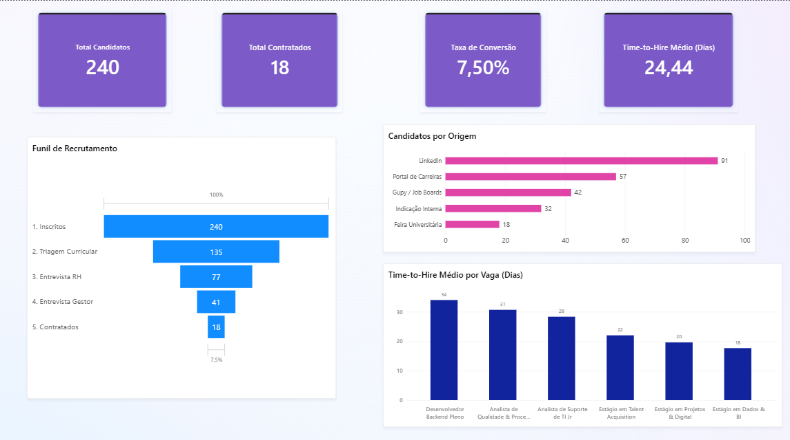
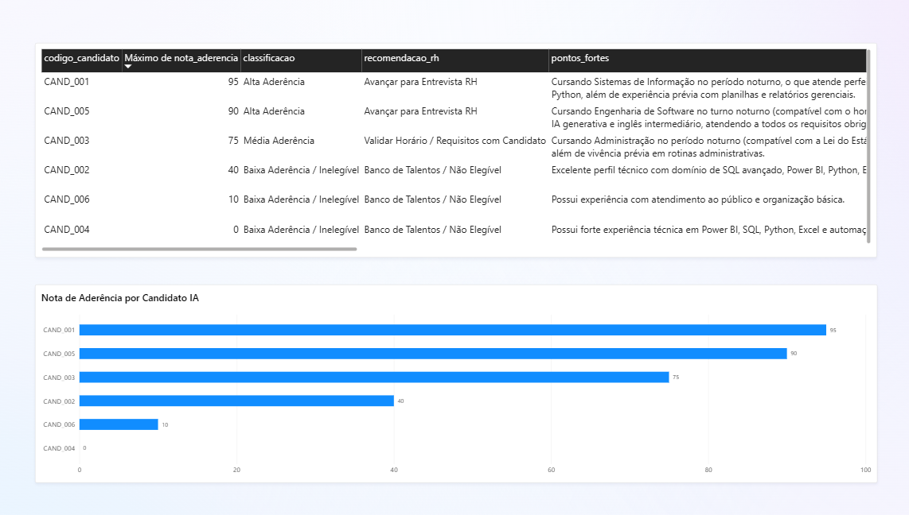

# Dashboard de Talent Acquisition & Triagem Assistida por IA

*(Scroll down for the [English Summary](#english-summary) — Analytics Dashboard & AI Screening Automation)*

Projeto prático de **People Analytics e Automação com IA**, combinando **Python**, **API do Google Gemini**, **modelagem relacional** e **Power BI** para apoiar rotinas de Talent Acquisition (funil de recrutamento, *time-to-hire*, origem dos candidatos e triagem inicial assistida por IA).

> **Nota sobre dados e LGPD:** Todos os dados e currículos presentes neste repositório são **100% fictícios e anonimizados** (identificados apenas por códigos como `CAND_001`), seguindo boas práticas de minimização de dados (LGPD) e mitigação de viés. A IA atua apenas como **apoio à decisão humana** — nunca reprova ou contrata de forma autônoma.

---

## Visão Geral da Solução

1. **Base Sintética Relacional (`scripts/gerar_base_ficticia.py`):**
   - Gera **240 candidaturas fictícias** (`data/candidaturas_funil.csv`) e **511 registros de passagem por etapa** (`data/historico_etapas.csv`), estruturados em relacionamento **`1:N`** por `id_candidatura`.
   - Essa modelagem permite calcular o **funil acumulado real** (`240 Inscritos → 135 Triagem → 77 Entrevista RH → 41 Gestor → 18 Contratados`) sem duplicar candidatos na média de *Time-to-Hire*.
2. **Triagem Inicial com API do Gemini (`scripts/triagem_ia.py`):**
   - Lê os requisitos da vaga (`data/vagas_requisitos.json`) e 6 currículos anonimizados (`data/curriculos_ficticios/*.txt`).
   - Consulta a API oficial `google-genai` (com **saída JSON estruturada** e fallback automático entre modelos) para gerar nota de aderência (`0–100`), classificação, pontos fortes, pontos de atenção (como conflito de turno ou regras da **Lei do Estágio**) e recomendação para o RH.
   - Exporta o resultado pronto para planilha e BI em `output/triagem_ia_resultado.csv`.
3. **Consolidação para Excel (`scripts/exportar_excel.py`) & Dashboard no Power BI (`dashboard/`):**
   - Consolida as três tabelas em `data/base_talent_acquisition.xlsx` para consumo direto no Power BI Desktop.
   - **Página 1 — Visão Geral de Talent Acquisition:** Cartões de KPI (`Total Candidatos`, `Total Contratados`, `Taxa de Conversão` e `Time-to-Hire Médio`), Funil de Recrutamento, Origem dos Candidatos e Tempo de Contratação por Vaga.
   - **Página 2 — Triagem Assistida por IA:** Ranking de aderência por candidato, justificativas técnicas e alertas de requisitos/elegibilidade gerados pelo script em Python.

---

## Prévia do Dashboard (Power BI)

### Página 1 — Visão Geral de Talent Acquisition


### Página 2 — Triagem Assistida por IA


---

## Tecnologias Utilizadas

- **Python 3.11** (`google-genai`, `python-dotenv`, `openpyxl`, `csv`, `json`)
- **Google Gemini API** (saída estruturada via JSON Schema)
- **Power BI Desktop** (Power Query, Modelagem Relacional `1:N`, Medidas DAX e Visualização)
- **Git & GitHub** (controle de versão e proteção de credenciais via `.env` + `.gitignore`)

---

## Estrutura do Projeto

```text
ta-analytics-ai-screening/
├── data/
│   ├── candidaturas_funil.csv         # 240 candidaturas fictícias (1 linha por candidato)
│   ├── historico_etapas.csv           # 511 registros de passagem no funil (relação 1:N)
│   ├── base_talent_acquisition.xlsx   # Planilha consolidada com as 3 abas para o Power BI
│   ├── vagas_requisitos.json          # Requisitos obrigatórios e desejáveis da vaga-teste
│   └── curriculos_ficticios/          # 6 currículos fictícios anonimizados (CAND_001 a CAND_006)
├── scripts/
│   ├── gerar_base_ficticia.py         # Gera os CSVs sintéticos reproduzíveis (seed fixa)
│   ├── triagem_ia.py                  # Integração com Gemini API para triagem estruturada
│   └── exportar_excel.py              # Consolida os CSVs em arquivo Excel (.xlsx)
├── output/
│   └── triagem_ia_resultado.csv       # Saída estruturada gerada pela API do Gemini
├── dashboard/                         # Arquivo do Power BI e capturas de tela do painel
├── .env.example                       # Modelo seguro de variável de ambiente (GEMINI_API_KEY)
├── .gitignore
└── requirements.txt
```

---

## Como Executar Localmente

1. **Instale as dependências:**
   ```bash
   pip install -r requirements.txt
   ```
2. **Configure sua chave gratuita da API do Gemini:**
   - Copie `.env.example` para `.env` e adicione sua chave obtida no [Google AI Studio](https://aistudio.google.com/apikey):
     ```env
     GEMINI_API_KEY=sua_chave_aqui
     ```
3. **Execute os scripts:**
   ```bash
   python scripts/gerar_base_ficticia.py
   python scripts/triagem_ia.py
   python scripts/exportar_excel.py
   ```
4. **Abra o dashboard** na pasta `dashboard/` utilizando o Power BI Desktop.

---

<a id="english-summary"></a>
## English Summary — Analytics Dashboard & AI Screening Automation

Hands-on **Data Analytics & AI Automation** project combining **Python**, **Google Gemini API**, **relational data modeling (`1:N`)**, and **Power BI**:

- **Synthetic Recruitment Dataset (`240` candidates / `511` stage events):** Modeled across two related tables (`candidaturas_funil` and `historico_etapas`) to compute accurate cumulative funnel conversion (`7.50%`), source analysis, and average **Time-to-Hire** (`24.44 days`) without double-counting candidates.
- **AI-Assisted Resume Screening (`scripts/triagem_ia.py`):** Reads anonymized sample resumes (privacy-by-design / LGPD mindset) and job requirements, calls the official `google-genai` SDK with strict **JSON Schema structured output** and automatic model fallback, and exports structured scores, strengths, and eligibility alerts to CSV/Excel.
- **Interactive Power BI Dashboard:** Tracks recruitment funnel metrics, candidate sources, time-to-hire by role, and AI screening rankings in a clean 2-page executive report.

**Autor / Author:** Henrique Gnatkovski de Almeida — [LinkedIn](https://www.linkedin.com/in/henrique-gnatkovski-de-almeida-219397301) | [GitHub](https://github.com/henriquegnat)
